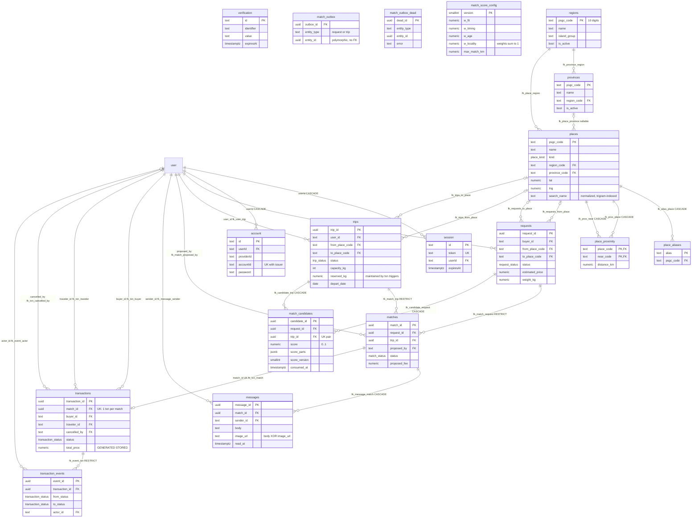

# Database schema

Reference for `backend/schema/tables/*.sql` — a **pull-only snapshot** of the live Neon DB
(regenerate with `scripts/pull-schema.sh`; the live DB is the source of truth).
This diagram is maintained by hand and shows key columns only (PKs, FKs, notable fields).
What each table is for: see [TABLES.md](./TABLES.md).

## ER diagram

## Notes

- **Standalone tables (no FK edges above):** `verification` (Better Auth, keyed by
  `identifier`), `match_outbox` / `match_outbox_dead` (polymorphic `entity_type` +
  `entity_id` pointing at `requests`/`trips`, filled by triggers, drained by
  `npm run worker:match`), `match_score_config` (versioned scoring weights).
- **Cardinality symbols**: `||` exactly one, `|o` zero or one, `o{` zero or more.
  `matches ||--o| transactions` means each transaction has exactly one match, while a
  match may have no transaction yet; `places |o--o{ requests` means a request may have
  no place set (nullable FK).
- Enums live in `../schema/types.sql`; non-trigger functions (`process_match_outbox`,
  `resolve_place`, `search_places`, …) in `../schema/functions.sql`.
- Naming: uuid-v7 PKs `<entity>_id`, prefixes `idx_`/`fk_`/`chk_`/`uq_`/`trg_`/`fn_`;
  `pg_attver=…` lines in the SQL are pg_dump artifacts — ignore them.
